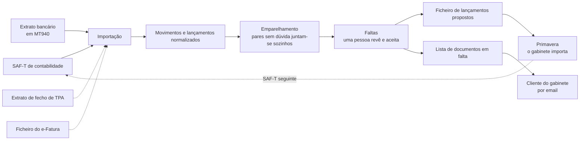
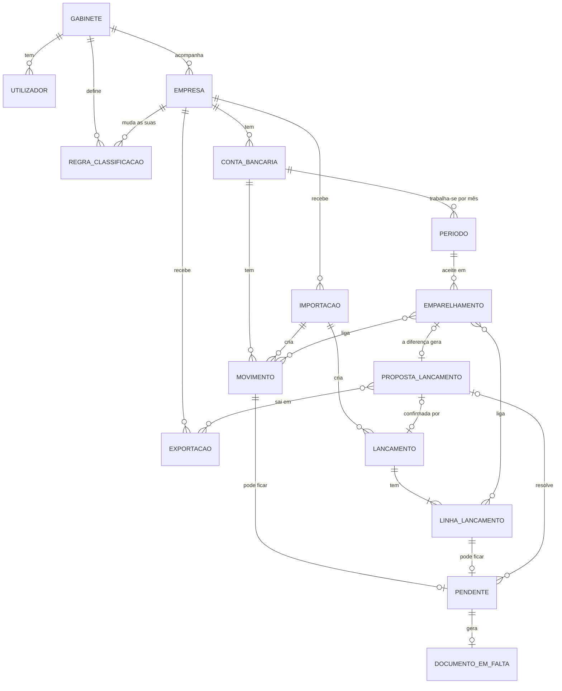

# Modelo de domínio das conciliações

- **Estado:** Rascunho. Parte do questionário ao gabinete (#4) e dos spikes (#5, #6). Atualizado a 2026-11-17 com as respostas do gabinete (#7) e o que se aprendeu com a app interna do gabinete (#28). Passa a **Aceite** com os requisitos validados (#8).
- **Tickets:** #9, #28 (épico #1)
- **Requisitos:** CB-01 a CB-06, CT-01 a CT-03, EF-01 a EF-03, GL-01 a GL-09

Marcas: ✅ confirmado pelo gabinete ou decidido com o utilizador · ⚠️ deduzido, por validar · ❓ em aberto.

Há um espelho desta página no Notion, na página principal do Bate Certo ("Modelo de domínio"). **A versão que vale é esta.** Uma mudança entra por PR e depois copia-se para o Notion.

## 1. Para que serve

- Dá nomes comuns às coisas: o que é um movimento, um emparelhamento, um pendente.
- Dá um identificador a cada regra de negócio (R1, R2…). Os testes levam esse identificador no nome (ADR-005, secção 5), e assim sabe-se que testes provam cada regra.
- É a base do ADR-001 (a lógica de negócio fica separada da base de dados e da interface), do ADR-003 (separação dos dados) e do ADR-004 (que dados se guardam).

Não é o esquema da base de dados. Esse faz-se na fundação (E1, #16), a partir daqui.

## 2. O fluxo

### Como o gabinete trabalha hoje ✅

1. O cliente entrega os extratos em PDF (alguns digitalizados) ou, num banco, por carta.
2. A app interna do gabinete converte cada PDF num ficheiro MT940.
3. O gabinete importa o MT940 no Primavera (Caixas e Bancos → Reconciliação Bancária). A **conciliação automática** do Primavera junta os pares e mostra as faltas.
4. As colaboradoras lançam as faltas à mão na contabilidade (comissões, prestações, TPA), voltam à reconciliação, atualizam e conciliam.

O trabalho manual está no passo 4. Hoje não importam lançamentos por ficheiro, e nenhum programa os gera (resposta da sessão #7).

### Onde entra o Bate Certo

1. **Entradas:**
   - o SAF-T de contabilidade, exportado do Primavera, com os lançamentos e o plano de contas ✅;
   - os extratos bancários em MT940, o ficheiro que a app interna já gera ⚠️ (proposta: assim o Bate Certo não precisa de ler PDF);
   - o extrato de fecho de TPA, que alguns bancos dão, para encontrar as comissões dos TPA ⚠️;
   - o ficheiro exportado do e-Fatura, carregado à mão ⚠️ (proposta, por debater no #15).
2. **Normalizar:** cada fonte é convertida no mesmo formato interno: valores em cêntimos, datas e conta.
3. **Emparelhar:** o sistema junta os pares sem dúvida e propõe os outros, por níveis (R2, R6). Corre por trás.
4. **Rever as faltas:** o ecrã principal mostra **o que ficou sem par e o lançamento proposto para cada falta** ✅ (decidido a 2026-11-16). Uma pessoa aceita, corrige ou rejeita (R2). O que fica sem par passa a pendente, com uma causa (R11). A vista completa da conciliação, para gabinetes que não usam a conciliação automática do Primavera, fica para mais tarde.
5. **Saídas:** um ficheiro com os lançamentos propostos e aceites, para importar no Primavera (GL-03) ❓, e a lista de documentos em falta por cliente (GL-04) ✅.
6. **Regresso:** o gabinete importa o ficheiro no Primavera e concilia no Primavera, como hoje. No SAF-T seguinte, esses lançamentos voltam a entrar e ligam-se às propostas que os originaram (R14).

O Bate Certo **nunca escreve no Primavera** (R1): é o gabinete que importa o ficheiro.

❓ **O maior risco:** ainda não se sabe se o Primavera do gabinete importa lançamentos, em que formato, e se os lançamentos importados aparecem na reconciliação bancária para se conciliarem. Testa-se na empresa de demonstração antes de construir (#29).

## 3. Entidades

- Um movimento pode ter vários emparelhamentos ao longo do tempo (os desfeitos ficam no histórico), mas só um **aceite** (R7).
- Um emparelhamento liga movimentos a linhas de lançamento. Pode ter um dos lados vazio quando se anula a si próprio: um movimento e o seu estorno, que somam zero (R6).
- **Todas as entidades pertencem a uma empresa**, direta ou indiretamente, e tudo o que se liga entre si pertence à mesma empresa (R3, R15). O diagrama não mostra todas essas ligações, para se ler melhor.

| Entidade | O que é | O que guarda (principal) | Notas |
|---|---|---|---|
| **Gabinete** | O cliente do Bate Certo: um gabinete de contabilidade. | Nome, utilizadores, empresas. | É a primeira fronteira da separação dos dados (R3). |
| **Utilizador** | Uma pessoa do gabinete: contabilista certificado ou técnico. | Nome, papel, gabinete. | Aceita propostas e fecha períodos. Fica registado quem fez o quê (GL-06). Previstos 3 a 5 em simultâneo (GL-05) ⚠️. |
| **Empresa** | Um cliente do gabinete, com a sua contabilidade. | NIF, nome, plano de contas (do SAF-T). | Cerca de 45 por gabinete (GL-01) ✅. É a segunda fronteira da separação (R3). |
| **Conta bancária** | Uma conta de uma empresa num banco. | Empresa, banco, IBAN, conta contabilística correspondente (subconta da 12). | 2 a 3 por empresa (CB-02) ⚠️. |
| **Período** | Um mês de trabalho de uma conta bancária. | Conta, mês, estado, quem fechou e quando, a fotografia do fecho (saldo do banco, saldo da contabilidade e pendentes nesse momento) e as reaberturas (quem, quando, motivo). | É a unidade de trabalho (R10). A fotografia não muda depois do fecho. |
| **Importação** | O registo de um ficheiro carregado. | Tipo (SAF-T, extrato, e-Fatura), empresa, conta (nos extratos), quem, quando, impressão digital do ficheiro, intervalo de datas, saldo inicial e final (nos extratos). | Impede importar o mesmo ficheiro duas vezes e permite confirmar a cadeia de saldos (R4). |
| **Movimento** | Uma linha do extrato bancário. | Conta, data, data-valor, valor em cêntimos com sinal, descritivo, referência. | Sinal: positivo é dinheiro que entra, e corresponde a um débito na conta 12. A empresa é a da conta, e a importação tem de ser da mesma empresa e conta. |
| **Lançamento** | Um registo da contabilidade, lido do SAF-T. | Empresa, diário, número do documento, data, linhas. | O Bate Certo só o lê. |
| **Linha de lançamento** | Uma linha de um lançamento. | Conta, lado (débito ou crédito), valor em cêntimos, descrição. | Na bancária, interessam as linhas da conta 12 da conta bancária. |
| **Emparelhamento** | A ligação entre movimentos e linhas de lançamento que representam o mesmo dinheiro. | Empresa, conta, período onde foi aceite, nível (R6), estado, diferença, proposta que explica a diferença, quem aceitou e quando. | O coração do sistema. |
| **Pendente** | Um movimento ou uma linha sem par no fim da revisão. | Empresa, origem, causa (R11), estado. | Pode passar para o mês seguinte. |
| **Regra de classificação** | Uma regra que diz como tratar um tipo de movimento. | Gabinete, empresa (se for uma alteração de uma empresa), padrão do descritivo, conta, diário e, nas despesas, taxa de IVA e percentagem dedutível. | As regras são do gabinete e cada empresa pode mudar as suas (R8). Por exemplo, as comissões de um banco. |
| **Proposta de lançamento** | Um lançamento que o Bate Certo sugere: comissões, encargos, prestações, ou um fecho de TPA. | Empresa, dia do extrato, linhas a débito e a crédito, regra que a originou, pendentes ou emparelhamento que resolve, estado, quem aceitou, lançamento do Primavera que a confirmou. | Débito = crédito (R9). Só sai no ficheiro depois de aceite (R2). Junta os movimentos de um dia do extrato, com uma linha da conta 12 por movimento (R16). |
| **Exportação** | Um ficheiro gerado para importar no Primavera. | Empresa, propostas incluídas, motivo (primeira exportação ou reexportação), quem gerou, quando. | Um ficheiro é sempre de uma só empresa, porque o Primavera importa para uma empresa de cada vez. Formato ❓: o gabinete não importa lançamentos hoje (GL-03, #29). |
| **Documento em falta** | Um item da lista a enviar ao cliente. | Empresa, período, movimento ou fatura de origem, descrição, estado. | Vem do banco e do e-Fatura. Hoje a lista é feita em Word e enviada só por email (GL-04) ✅. |

A conciliação e-Fatura (EF-01) e a de terceiros (CT-01 a CT-03) ainda não estão modeladas. ⚠️ A hipótese é que usem o mesmo emparelhamento: no e-Fatura, um documento comunicado à AT ↔ um lançamento de compra; nos terceiros, uma fatura ↔ um ou mais pagamentos. Modela-se quando se decidir a ordem dos épicos (#15).

## 4. Regras de negócio

Cada regra tem um identificador que não muda. Se uma regra deixar de valer, marca-se como **retirada** e o número não se reutiliza.

As regras R1 a R12 foram propostas na conversa de 2026-11-04, a partir do questionário e dos spikes. As R13 a R15 nasceram na revisão deste documento. A R16 e as mudanças às R2, R6, R8, R10 e R11 foram decididas com o utilizador a 2026-11-16 e 2026-11-17, a partir das respostas do gabinete (#7) e da app interna do gabinete (#28). **O merge deste rascunho aprova a estrutura e as regras como hipótese de trabalho, não como decisão final.** Os pontos marcados ⚠️ ou ❓ continuam por validar, e o documento só passa a Aceite no #8.

### R1. Nunca escreve no Primavera ✅

O Bate Certo não se liga à base de dados nem à API do Primavera para escrever. Entrega ficheiros (o TXT e a lista de faltas), e é o gabinete que os importa ou envia.

- **Porquê:** um erro de escrita no ERP estraga a contabilidade de um cliente. O gabinete já importa ficheiros hoje e prefere esse caminho (GL-03). Decidido a 2026-11-04.
- **Como se prova:** o sistema não tem credenciais nem ligação ao Primavera. Verifica-se na revisão de cada PR, e não por um teste.
- **Requisitos:** CB-01, GL-02, GL-03.

### R2. O que muda a contabilidade é sempre aceite por uma pessoa ✅

- **Propostas de lançamento:** nenhuma passa a "aceite" sem a ação de um utilizador. Fica registado quem aceitou e quando.
- **Emparelhamentos sem dúvida** (nível exato do R6: o mesmo valor e sentido, dentro da janela, e um só candidato possível) juntam-se sozinhos, sem ninguém ter de os ver. Ficam registados como aceites pelo sistema e podem ser desfeitos (R7). Não mudam nada no Primavera.
- **Emparelhamentos com dúvida** (por exemplo, valores repetidos) ficam sugeridos e confirmam-se por uma pessoa, um a um ou em lote, com um clique.

- **Porquê:** a responsabilidade pela contabilidade é do contabilista certificado, por isso nada chega ao Primavera sem uma pessoa. Juntar os pares sem dúvida não muda a contabilidade e poupa o trabalho que o Primavera já faz na conciliação automática. Decidido a 2026-11-16.
- **Como se prova:** unitário (sem um utilizador, uma proposta não muda de estado; um par com mais de um candidato nunca se junta sozinho) e ponta a ponta no fluxo de revisão.
- **Requisitos:** GL-06.

### R3. Os dados são separados por empresa e por gabinete

Cada dado pertence a uma empresa, e cada empresa a um gabinete. Um utilizador só vê e altera as empresas do seu gabinete. Uma operação numa empresa nunca lê nem altera os dados de outra.

- **Porquê:** sigilo profissional dos contabilistas (OCC) e RGPD. Uma fuga entre empresas ou entre gabinetes é o erro mais grave possível.
- **Como se prova:** integração com a base de dados real, sempre com três casos: o normal, sem permissão (recusado) e outra empresa (não vê, não altera) (ADR-005, secção 6). A forma técnica decide-se no ADR-003 (#12). A coerência dentro de uma operação é o R15.
- **Requisitos:** GL-01, GL-09.

### R4. As importações ficam registadas e nunca se duplicam

Cada ficheiro importado fica registado, com a sua impressão digital. O mesmo ficheiro carregado duas vezes é recusado.

Quando um extrato se sobrepõe a outro já importado (por exemplo, de 15/01 a 15/02, depois de um de 01/01 a 31/01), só se compara o **intervalo de datas em comum**. Nesse intervalo, os movimentos iguais contam-se, e fica o maior número visto num só ficheiro. Assim, duas transferências de 10 € no mesmo dia, com o mesmo descritivo, continuam a ser duas. Os saldos inicial e final de cada extrato confirmam o resultado: o saldo anterior mais os movimentos tem de dar o saldo final.

- **Porquê:** os extratos de meses seguidos sobrepõem-se muitas vezes. Um movimento duplicado gera uma diferença falsa, e um movimento apagado esconde dinheiro.
- ⚠️ **Por validar:** o que torna dois movimentos "iguais". A proposta é a conta, a data, o valor, o descritivo e a referência, quando o banco a dá. Os extratos quase sempre trazem o saldo inicial e o final; quando falta o final, avisa-se e a cadeia de saldos não se confirma.
- **Como se prova:** unitário (sobreposição parcial, movimentos repetidos legítimos) e invariante (importar o mesmo conteúdo duas vezes dá sempre o mesmo resultado que importar uma; a cadeia de saldos bate).
- **Requisitos:** CB-02.

### R5. Os valores guardam-se em cêntimos inteiros

Todos os valores em euros guardam-se e calculam-se como números inteiros de cêntimos. Nunca se usam números com vírgula flutuante. Num movimento, o sinal positivo é dinheiro que entra na conta (um débito na conta 12) e o negativo é dinheiro que sai (um crédito).

- **Porquê:** com vírgula flutuante, 0,10 + 0,20 não dá exatamente 0,30. Numa conciliação, um cêntimo de diferença é uma diferença.
- **Como se prova:** invariante (somar e separar valores nunca perde nem ganha cêntimos) e ficheiros de referência na leitura de cada formato.
- **Requisitos:** CB-05 (diferenças de cêntimos).

### R6. O emparelhamento faz-se por níveis

**A janela** ✅ (decidido a 2026-11-16, com os valores que a app interna do gabinete já usa): um movimento e uma linha podem ser par com **até 45 dias** de diferença, ou **até 60 dias** quando a contabilidade vem antes do banco (cheques). Conta a **data do movimento**, não a data-valor. Os valores mudam-se nas definições do gabinete.

O sistema tenta, por esta ordem:

1. **Exato:** o mesmo valor e sentido, dentro da janela, e **um só candidato possível**. Junta-se sozinho (R2).
2. **Provável:** o mesmo valor e sentido, mas mais do que um candidato. Desempata-se pela proximidade das datas e pelas palavras e números comuns no descritivo ou na referência. Fica sugerido para uma pessoa confirmar.
3. **Vários para um:** um movimento corresponde a várias linhas, ou o contrário, com até 8 movimentos a ±7 dias uns dos outros ⚠️ (valores da app interna). Por exemplo, um pagamento que liquida várias faturas, ou a comissão e o imposto do selo contra um só lançamento. Se houver uma diferença (a comissão que o banco já descontou), o emparelhamento só fica completo com uma proposta de lançamento para essa diferença.
4. **Manual:** a pessoa escolhe o par.

Casos especiais:

- **Valores repetidos** (por exemplo, salários iguais): o sistema não escolhe sozinho um par. Quando há o mesmo número de movimentos e de linhas com o mesmo valor no período, propõe-nos como um grupo, para confirmar de uma vez (R2). Se não houver, vão para a escolha manual, com os candidatos à vista.
- **Anulações:** um movimento e o seu estorno (+100 € e −100 €) emparelham-se entre si, sem linha de lançamento, porque somam zero.
- **TPA** ✅ (sessão #7):
  - Cada **fecho** da maquineta dá uma entrada no banco, normalmente no próprio dia. Pode haver mais do que um fecho no mesmo dia, por isso junta-se por fecho, não por dia.
  - Nalguns bancos entra o valor bruto e a comissão sai numa linha à parte; noutros entra só o líquido (**comissão escondida**, a maior dor). Há TPA sem comissão.
  - A comissão escondida encontra-se comparando a entrada no banco com o talão de fecho do TPA ou com o extrato de fecho de TPA do banco, quando existe ⚠️.
- **Sugestões para os pendentes** ⚠️ (ideia da app interna): para o que fica sem par, o sistema aponta causas prováveis: dois dígitos trocados (45,30 ↔ 43,50), sinal trocado, duplicados e valores quase iguais.

Em qualquer emparelhamento aceite: a soma dos movimentos = a soma das linhas + a diferença, e a diferença tem uma proposta de lançamento associada.

- **Porquê:** o gabinete emparelha sobretudo pelo valor e pela data, e concilia à mão os valores repetidos (CB-05). Os TPA são a maior dor (CB-03), e a comissão descontada tem de chegar à contabilidade, senão o saldo da conta 12 nunca bate com o extrato.
- **Como se prova:** unitário por nível, com os limites (fronteira da janela, cêntimos, fim do mês, dois fechos de TPA no mesmo dia). Invariante: a igualdade acima.
- **Requisitos:** CB-03, CB-04, CB-05.

### R7. Cada movimento tem no máximo um emparelhamento aceite

Um movimento, ou uma linha de lançamento, nunca está em dois emparelhamentos aceites ao mesmo tempo. Pode aparecer em várias sugestões (propostas pelo sistema), mas, quando uma é aceite, as outras caem.

Desfazer um emparelhamento ("despicar") é uma ação explícita e fica no histórico. Para tirar só um movimento de um grupo (por exemplo, um dia errado num depósito de TPA), desfaz-se o grupo e o sistema cria logo um grupo novo com o que resta, pronto a aceitar com um clique (R2). Assim, nenhum grupo aceite fica a violar a igualdade do R6.

- **Porquê:** hoje, um erro num documento de TPA obriga a despicar o documento todo e a refazê-lo à mão (CB-03). O Primavera recusa alterar um documento enquanto houver movimentos dele conciliados (visto na sessão #7).
- **Como se prova:** invariante (depois de qualquer sequência de emparelhar e desfazer, nenhum movimento tem dois emparelhamentos aceites) e unitário no desfazer parcial.
- **Requisitos:** CB-03.

### R8. As regras de classificação são do gabinete, e cada empresa pode mudar as suas ✅

O gabinete define como tratar tipos de movimento, e essas regras servem para todas as empresas: por exemplo, "o descritivo contém COMISS → conta de gastos X, imposto do selo na conta Y, diário Z". Uma empresa pode ter uma alteração sua a uma regra, que só vale para ela e se sobrepõe à do gabinete.

- **Porquê:** o gabinete usa as mesmas contas para quase todas as empresas (por exemplo, nos TPA: banco 1201, caixa 111, comissões 622714, definidas pelo gabinete) e a app interna já tem uma tabela de tipos de despesa igual para todas. Algumas empresas fogem à regra. Hoje as comissões, os encargos e as prestações lançam-se um a um (CB-04). Decidido a 2026-11-16.
- **Como se prova:** unitário (aplicar regras; a alteração da empresa ganha à do gabinete) e integração (a alteração de uma empresa não se aplica a outra).
- **Requisitos:** CB-04.

### R9. Em cada lançamento, débito = crédito

Nenhuma proposta de lançamento é aceite nem exportada se o total a débito for diferente do total a crédito.

- **Porquê:** é a regra base das partidas dobradas. Um lançamento desequilibrado é recusado pelo Primavera ou, pior, entra errado.
- **Como se prova:** invariante (toda a proposta gerada balanceia) e ficheiros de referência do TXT, comparados carácter a carácter.
- **Requisitos:** GL-03, CB-04.

### R10. Trabalha-se por empresa, conta e mês, com fecho

A conciliação faz-se por período: uma conta bancária de uma empresa, num mês. Um movimento pertence ao mês da sua data de movimento ✅ (não da data-valor). Um emparelhamento pertence ao período aberto onde é aceite, mesmo que ligue coisas de meses diferentes: um cheque lançado em janeiro e descontado em fevereiro emparelha-se em fevereiro, e janeiro não muda.

Ao fechar um período, guarda-se uma fotografia: o saldo do banco, o saldo da contabilidade e os pendentes desse momento. A fotografia não muda depois. Num período fechado não se aceitam emparelhamentos nem propostas. Se um ficheiro importado trouxer um movimento novo com data de um período fechado, o movimento entra, mas fica um alerta no período e só se trata depois de um utilizador o reabrir.

**Reabrir** ✅ (decidido a 2026-11-16): qualquer utilizador pode reabrir um período, mas tem de dizer o motivo, e fica registado quem reabriu e quando. Mais tarde, uma definição do gabinete ("só os administradores reabrem períodos") pode restringir isto.

- **Porquê:** é assim que o gabinete trabalha (mês a mês, no fecho). Um período já entregue não deve mudar sem se saber. São poucas pessoas que confiam umas nas outras, e trancar só atrapalhava; o registo chega para saber o que mudou.
- ❓ **Em aberto:** se o mês serve para todas as empresas: há empresas conciliadas só no trimestre ou só no fim do ano ("depende da empresa", GL-01).
- **Como se prova:** unitário com relógio controlado (fronteira do mês) e integração (num período fechado, as alterações são recusadas e um movimento novo gera alerta).
- **Requisitos:** CB-01, GL-01.

### R11. Cada pendente tem uma causa

No fim da revisão, cada movimento ou linha sem par fica como pendente, com uma causa: falta o documento, falta lançar, diferença de datas (por exemplo, um cheque ainda não descontado), erro, ou outra. Os pendentes por falta de documento alimentam a lista de documentos em falta. Os de "falta lançar" resolvem-se com uma proposta de lançamento, que junta os pendentes de um dia do extrato (R16). Os pendentes que passam de mês continuam na lista até se resolverem.

Como o gabinete trata hoje um movimento sem documento ✅ (questionário e sessão #7):

1. Se o documento se tira do banco (comissões, transferências), tira-se.
2. Se não, pede-se ao cliente, na lista de faltas, por email.
3. As faltas passam, no máximo, de dezembro para janeiro. O que continuar sem documento vai para despesas não devidamente documentadas.

- **Porquê:** a lista de faltas é trabalho comum às três conciliações (GL-04), e as faltas vêm do banco e do e-Fatura. As faltas que passam de ano ficam numa lista própria (CB-06).
- ⚠️ **Por validar:** os nomes que o gabinete dá às causas.
- **Como se prova:** unitário (um pendente sem causa não deixa fechar o período) e ficheiro de referência da lista de faltas.
- **Requisitos:** CB-06, GL-04, EF-01.

### R12. Não se guardam senhas da AT nem dados reais

O Bate Certo nunca guarda credenciais do Portal das Finanças nem do homebanking dos clientes. O código, os testes e os dados de exemplo nunca têm dados reais: são fictícios (gerador de dados do ADR-005) ou da empresa de demonstração do Primavera.

- **Porquê:** sigilo profissional e RGPD. Uma senha guardada é um risco que o gabinete não precisa de correr, porque os ficheiros exportados chegam.
- **Como se prova:** revisão de cada PR, secret scanning e a origem dos dados de teste (ADR-005, secção 7).
- **Requisitos:** EF-03.

### R13. Cada proposta exporta-se uma só vez, salvo pedido explícito

Uma proposta de lançamento que já saiu num TXT não volta a sair noutro, a não ser que um utilizador peça para a reexportar, com o motivo (por exemplo, a importação no Primavera falhou). Cada exportação fica registada.

Se for preciso anular uma proposta que já foi importada no Primavera (por exemplo, depois de reabrir o período), a proposta passa a **anulada** e o sistema propõe um estorno, que segue o caminho normal: aceitar, exportar, importar.

- **Porquê:** importar o mesmo TXT duas vezes no Primavera duplica os lançamentos. É o mesmo princípio do R4, mas na saída. E, como o Bate Certo não escreve no Primavera (R1), a única forma de corrigir um lançamento já importado é outro lançamento.
- **Como se prova:** unitário e invariante (gerar duas exportações seguidas sem pedido de reexportação nunca repete propostas).
- **Requisitos:** GL-03.

### R14. O SAF-T seguinte confirma o que foi exportado ⚠️

Quando chega um SAF-T novo, as linhas que correspondem a propostas exportadas ligam-se a essas propostas, que passam a **confirmadas no Primavera**. Não aparecem como pendentes novos, nem como lançamentos a propor outra vez.

Se o SAF-T novo mudar ou apagar um lançamento que está num emparelhamento aceite, o emparelhamento passa a precisar de revisão, com um alerta. Nunca se desfaz em silêncio.

- **Porquê:** sem isto, cada comissão exportada voltava como uma linha sem par, e o gabinete via o mesmo trabalho duas vezes ou lançava em dobro.
- ⚠️ **Por validar:** como reconhecer no SAF-T um lançamento que veio do ficheiro importado (número do documento, diário, descrição?). Depende do formato de importação do Primavera (#29).
- **Como se prova:** unitário e ficheiros de referência (um SAF-T de exemplo com as propostas importadas).
- **Requisitos:** GL-03.

### R15. Tudo o que se liga pertence à mesma empresa

Um emparelhamento só liga movimentos e linhas da mesma empresa e da mesma conta. Uma proposta só resolve pendentes da sua empresa. Um TXT só leva propostas de uma empresa. A importação de um extrato tem de ser da mesma empresa que a conta bancária.

- **Porquê:** é a separação dos dados (R3) dentro de cada operação, e o Primavera importa um TXT para uma empresa de cada vez.
- **Como se prova:** unitário (ligar elementos de empresas diferentes é recusado), logo na lógica de negócio, além da integração do R3.
- **Requisitos:** GL-01, GL-03.

### R16. As propostas de lançamento agrupam-se por dia do extrato ✅

As propostas de lançamento de uma conta bancária juntam-se num documento **por cada dia do extrato**. Dentro do documento, cada movimento do banco tem **a sua linha na conta 12**: por exemplo, uma comissão de 5 € e o seu imposto do selo são duas linhas no banco, cada uma com a sua contrapartida.

- **Porquê:** no Primavera, cada linha da conta 12 concilia-se à parte, por isso uma linha por movimento mantém a reconciliação fácil. Mas o Primavera não deixa alterar um documento enquanto houver linhas dele conciliadas (R7), por isso um erro obriga a despicar o documento todo. Um documento por mês tornava cada erro muito caro; um por movimento enchia a contabilidade de documentos. Um por dia é o que o gabinete já faz hoje (documento "Extrato" por data). Decidido a 2026-11-17, em vez de um lançamento por mês.
- ⚠️ **Por validar:** se o formato de importação do Primavera aceita vários movimentos da conta 12 num só documento, e se aparecem na reconciliação como linhas separadas (#29).
- **Como se prova:** unitário (as propostas de dias diferentes nunca ficam no mesmo documento; cada movimento tem uma linha da conta 12) e ficheiros de referência do ficheiro de importação.
- **Requisitos:** CB-03, CB-04, GL-03.

## 5. Estados

| Entidade | Estados | Quem muda |
|---|---|---|
| Emparelhamento | sugerido → aceite → desfeito · sugerido → rejeitado · aceite → por rever (R14) · (sem dúvida) aceite pelo sistema → desfeito | O sistema junta os pares sem dúvida e sugere os outros; uma pessoa aceita, rejeita ou desfaz (R2, R7). |
| Proposta de lançamento | proposta → aceite → exportada → confirmada no Primavera · proposta → rejeitada · exportada ou confirmada → anulada | O sistema propõe; uma pessoa aceita ou anula; a exportação e o SAF-T seguinte mudam o resto (R2, R13, R14). |
| Período | aberto → fechado → reaberto (volta a aberto) | Uma pessoa; a reabertura leva motivo (R10). |
| Pendente | aberto → resolvido | Resolve-se com um emparelhamento, uma proposta aceite ou uma decisão da pessoa (R11). |
| Documento em falta | em falta → pedido → recebido · em falta → pedido → sem documento | Uma pessoa. "Sem documento" corresponde às despesas não documentadas (CB-06). |

## 6. Ligação aos requisitos

| Requisito | Entidades | Regras |
|---|---|---|
| CB-01 Complementar a conciliação do Primavera | Período | R1, R10 |
| CB-02 Ler extratos | Importação, Movimento | R4 |
| CB-03 Tratar movimentos de TPA | Emparelhamento, Proposta de lançamento | R6 (TPA, nível 3), R7, R16 |
| CB-04 Propor lançamentos de comissões e encargos | Regra de classificação, Proposta de lançamento | R6, R8, R9, R16 |
| CB-05 Emparelhar por valor e data | Emparelhamento | R5, R6 |
| CB-06 Movimentos sem documento | Pendente, Documento em falta | R11 |
| CT-01 a CT-03 Terceiros | ⚠️ ainda não modelado | — |
| EF-01 Conferir o e-Fatura | ⚠️ ainda não modelado; Documento em falta | R11 |
| EF-02 Talões pequenos | ⚠️ ainda não modelado | — |
| EF-03 Sem credenciais da AT | — | R12 |
| GL-01, GL-09 Dimensão e onde ficam os dados | Gabinete, Empresa | R3, R10, R15 |
| GL-02 Primavera no servidor do gabinete | — | R1 |
| GL-03 Ficheiro de lançamentos | Proposta de lançamento, Exportação | R1, R9, R13, R14, R15, R16 |
| GL-04 Lista de documentos em falta | Pendente, Documento em falta | R11 |
| GL-05 Utilizadores em simultâneo | Utilizador | — |
| GL-06 Quem resolveu cada diferença | Utilizador | R2 |
| GL-07 Dashboard, GL-08 Acesso dos clientes | Fora deste rascunho | — |

## 7. Ainda por validar

As perguntas da sessão (#7) ficaram respondidas a 2026-11-17. Falta:

1. **Importar lançamentos no Primavera:** se o Primavera do gabinete importa lançamentos, em que formato, se os lançamentos importados aparecem na reconciliação bancária para se conciliarem, e como se reconhecem no SAF-T. Testa-se na empresa de demonstração (#29) (R13, R14, R16).
2. Confirmar com o gabinete a janela de 45 dias (60 nos cheques) (R6).
3. Que bancos dão o extrato de fecho de TPA, e como se encontram as comissões escondidas nos que não dão (R6).
4. Se há empresas que não se conciliam todos os meses (R10).
5. Os nomes que o gabinete dá às causas dos pendentes (R11).

## 8. Fora deste documento

- O esquema da base de dados: na fundação (E1, #16).
- A stack e os nomes no código: ADR-001 (#10).
- A forma técnica da separação dos dados: ADR-003 (#12).
- Que dados se guardam, por quanto tempo e quem os vê: ADR-004 (#13).
