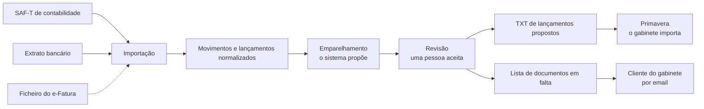
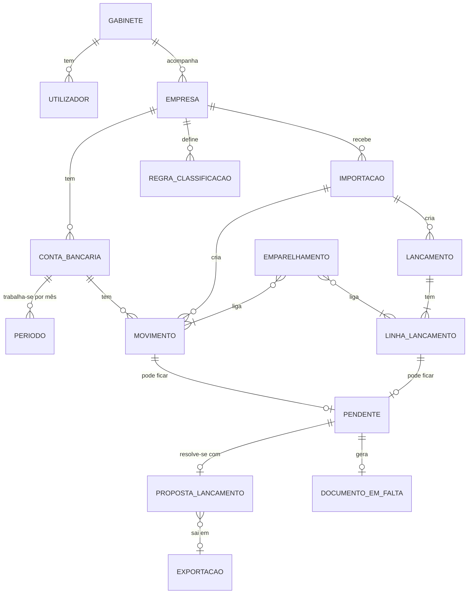

# Modelo de domínio das conciliações

- **Estado:** Rascunho. Parte do questionário ao gabinete (#4) e dos spikes (#5, #6). Valida-se na sessão no gabinete (#7) e nos requisitos (#8).
- **Ticket:** #9 (épico #1)
- **Requisitos:** CB-01 a CB-06, CT-01 a CT-03, EF-01 a EF-03, GL-01 a GL-09

Marcas: ✅ confirmado pelo gabinete ou decidido com o utilizador · ⚠️ deduzido, por validar · ❓ em aberto.

Há um espelho desta página no Notion, na página principal do Bate Certo ("Modelo de domínio"). **A versão que vale é esta.** Uma mudança entra por PR e depois copia-se para o Notion.

## 1. Para que serve

- Dá nomes comuns às coisas: o que é um movimento, um emparelhamento, um pendente.
- Dá um identificador a cada regra de negócio (R1, R2…). Os testes levam esse identificador no nome (ADR-005, secção 5), e assim sabe-se que testes provam cada regra.
- É a base do ADR-001 (a lógica de negócio fica separada da base de dados e da interface), do ADR-003 (separação dos dados) e do ADR-004 (que dados se guardam).

Não é o esquema da base de dados. Esse faz-se na fundação (E1, #16), a partir daqui.

## 2. O fluxo

1. **Entradas:** o SAF-T de contabilidade, exportado do Primavera, com os lançamentos e o plano de contas ✅. Os extratos dos bancos, por ficheiro (CSV/Excel configurável por banco e MT940) ✅. O ficheiro exportado do e-Fatura, carregado à mão ⚠️ (proposta, por debater no #15).
2. **Normalizar:** cada fonte é convertida no mesmo formato interno: valores em cêntimos, datas e conta.
3. **Emparelhar:** o sistema propõe pares entre o banco e a contabilidade, por níveis (R6).
4. **Rever:** uma pessoa aceita, corrige ou rejeita (R2). O que fica sem par passa a pendente, com uma causa (R11).
5. **Saídas:** um TXT com os lançamentos propostos e aceites, para importar no Primavera (GL-03) ✅, e a lista de documentos em falta por cliente (GL-04) ⚠️.

O Bate Certo **nunca escreve no Primavera** (R1): é o gabinete que importa o TXT.

## 3. Entidades

Um movimento pode ter vários emparelhamentos ao longo do tempo (os desfeitos ficam no histórico), mas só um ativo (R7).

| Entidade | O que é | O que guarda (principal) | Notas |
|---|---|---|---|
| **Gabinete** | O cliente do Bate Certo: um gabinete de contabilidade. | Nome, utilizadores, empresas. | É a primeira fronteira da separação dos dados (R3). |
| **Utilizador** | Uma pessoa do gabinete: contabilista certificado ou técnico. | Nome, papel, gabinete. | Aceita propostas e fecha períodos. Fica registado quem fez o quê (GL-06). Previstos 3 a 5 em simultâneo (GL-05) ⚠️. |
| **Empresa** | Um cliente do gabinete, com a sua contabilidade. | NIF, nome, plano de contas (do SAF-T). | Cerca de 45 por gabinete (GL-01) ✅. É a segunda fronteira da separação (R3). |
| **Conta bancária** | Uma conta de uma empresa num banco. | Banco, IBAN, conta contabilística correspondente (subconta da 12). | 2 a 3 por empresa (CB-02) ⚠️. |
| **Período** | Um mês de trabalho de uma conta bancária. | Conta, mês, estado (aberto ou fechado), quem fechou e quando. | É a unidade de trabalho (R10). |
| **Importação** | O registo de um ficheiro carregado. | Tipo (SAF-T, extrato, e-Fatura), empresa, quem, quando, impressão digital do ficheiro. | Impede importar o mesmo ficheiro duas vezes (R4). |
| **Movimento** | Uma linha do extrato bancário. | Conta, data, data-valor, valor em cêntimos com sinal, descritivo, referência. | Entra pela importação do extrato. |
| **Lançamento** | Um registo da contabilidade, lido do SAF-T. | Diário, número do documento, data, linhas. | O Bate Certo só o lê. |
| **Linha de lançamento** | Uma linha de um lançamento. | Conta, lado (débito ou crédito), valor em cêntimos, descrição. | Na bancária, interessam as linhas da conta 12 da conta bancária. |
| **Emparelhamento** | A ligação entre um ou mais movimentos e uma ou mais linhas de lançamento que representam o mesmo dinheiro. | Nível (R6), estado, diferença explicada (por exemplo, a comissão de um TPA), quem aceitou e quando. | O coração do sistema. |
| **Pendente** | Um movimento ou uma linha sem par no fim da revisão. | Origem, causa (R11), estado. | Pode passar para o mês seguinte. |
| **Regra de classificação** | Uma regra de uma empresa que diz como tratar um tipo de movimento. | Padrão do descritivo, conta e diário a usar. | Por exemplo, as comissões de um banco (R8). |
| **Proposta de lançamento** | Um lançamento que o Bate Certo sugere para resolver um pendente: comissões, encargos, prestações, TPA. | Linhas a débito e a crédito, regra que a originou, estado, quem aceitou. | Débito = crédito (R9). Só sai no TXT depois de aceite (R2). |
| **Exportação** | Um TXT gerado para importar no Primavera. | Propostas incluídas, quem gerou, quando. | Layout do Primavera: o da v9 é público; o da v10 ❓ (GL-03). |
| **Documento em falta** | Um item da lista a enviar ao cliente. | Empresa, período, movimento ou fatura de origem, descrição, estado. | Hoje a lista é feita em Word e enviada por email (GL-04) ⚠️. |

A conciliação e-Fatura (EF-01) e a de terceiros (CT-01 a CT-03) ainda não estão modeladas. ⚠️ A hipótese é que usem o mesmo emparelhamento: no e-Fatura, um documento comunicado à AT ↔ um lançamento de compra; nos terceiros, uma fatura ↔ um ou mais pagamentos. Modela-se quando se decidir a ordem dos épicos (#15).

## 4. Regras de negócio

Cada regra tem um identificador que não muda. Se uma regra deixar de valer, marca-se como **retirada** e o número não se reutiliza.

As regras R1 a R12 foram propostas na conversa de 2026-11-04, a partir do questionário e dos spikes. Só o R1 foi decidido de forma explícita ✅. As outras, e o R13, que é novo, ficam aprovadas com o merge deste documento. Os pontos marcados ⚠️ ou ❓ dentro de cada regra validam-se com o gabinete.

### R1. Nunca escreve no Primavera ✅

O Bate Certo não se liga à base de dados nem à API do Primavera para escrever. Entrega ficheiros (o TXT e a lista de faltas), e é o gabinete que os importa ou envia.

- **Porquê:** um erro de escrita no ERP estraga a contabilidade de um cliente. O gabinete já importa ficheiros hoje e prefere esse caminho (GL-03). Decidido a 2026-11-04.
- **Como se prova:** o sistema não tem credenciais nem ligação ao Primavera. Verifica-se na revisão de cada PR, e não por um teste.
- **Requisitos:** CB-01, GL-02, GL-03.

### R2. O sistema propõe, uma pessoa aceita

Nenhum emparelhamento e nenhuma proposta de lançamento passa a "aceite" sem a ação de um utilizador. Fica registado quem aceitou e quando.

- **Porquê:** a responsabilidade pela contabilidade é do contabilista certificado. Um erro automático que ninguém viu chega ao Primavera.
- ⚠️ **Por validar:** os emparelhamentos de nível exato podem ser aceites em lote, com um só clique.
- **Como se prova:** unitário (sem um utilizador, o estado não muda) e ponta a ponta no fluxo de revisão.
- **Requisitos:** GL-06.

### R3. Os dados são separados por empresa e por gabinete

Cada dado pertence a uma empresa, e cada empresa a um gabinete. Um utilizador só vê e altera as empresas do seu gabinete. Uma operação numa empresa nunca lê nem altera os dados de outra.

- **Porquê:** sigilo profissional dos contabilistas (OCC) e RGPD. Uma fuga entre empresas ou entre gabinetes é o erro mais grave possível.
- **Como se prova:** integração com a base de dados real, sempre com três casos: o normal, sem permissão (recusado) e outra empresa (não vê, não altera) (ADR-005, secção 6). A forma técnica decide-se no ADR-003 (#12).
- **Requisitos:** GL-01, GL-09.

### R4. As importações ficam registadas e nunca se duplicam

Cada ficheiro importado fica registado, com a sua impressão digital. O mesmo ficheiro carregado duas vezes é recusado. Um movimento que já existe não se cria de novo, mesmo que venha noutro ficheiro com datas sobrepostas.

- **Porquê:** os extratos de meses seguidos sobrepõem-se muitas vezes. Um movimento duplicado gera uma diferença falsa, ou um lançamento em dobro.
- ⚠️ **Por validar:** o que identifica um movimento repetido. A proposta é a conta, a data, o valor, o descritivo e a referência, quando o banco a dá.
- **Como se prova:** unitário e invariante (importar o mesmo conteúdo duas vezes dá sempre o mesmo resultado que importar uma).
- **Requisitos:** CB-02.

### R5. Os valores guardam-se em cêntimos inteiros

Todos os valores em euros guardam-se e calculam-se como números inteiros de cêntimos. Nunca se usam números com vírgula flutuante.

- **Porquê:** com vírgula flutuante, 0,10 + 0,20 não dá exatamente 0,30. Numa conciliação, um cêntimo de diferença é uma diferença.
- **Como se prova:** invariante (somar e separar valores nunca perde nem ganha cêntimos) e ficheiros de referência na leitura de cada formato.
- **Requisitos:** CB-05 (diferenças de cêntimos).

### R6. O emparelhamento faz-se por níveis

O sistema tenta, por esta ordem:

1. **Exato:** o mesmo valor, a mesma data e um só candidato possível.
2. **Provável:** o mesmo valor e a data dentro de uma janela de poucos dias, ou o descritivo ou a referência a ajudar. ⚠️ O tamanho da janela valida-se com o gabinete.
3. **Vários para um:** um movimento corresponde a várias linhas, ou o contrário. Por exemplo, o depósito de um TPA que junta várias vendas, ou um pagamento que liquida várias faturas. Pode ter uma diferença explicada, como a comissão que o banco já descontou.
4. **Manual:** a pessoa escolhe o par.

Quando há mais de um candidato com o mesmo valor (por exemplo, salários iguais), o sistema não escolhe sozinho: vai para a escolha manual, com os candidatos à vista.

- **Porquê:** o gabinete emparelha sobretudo pelo valor e pela data, e concilia à mão os valores repetidos (CB-05). Os TPA são a maior dor (CB-03).
- **Como se prova:** unitário por nível, com os limites (fronteira da janela, cêntimos, fim do mês). Invariante: a soma dos movimentos emparelhados é igual à soma das linhas mais a diferença explicada.
- **Requisitos:** CB-03, CB-05.

### R7. Cada movimento tem no máximo um emparelhamento ativo

Um movimento, ou uma linha de lançamento, nunca está em dois emparelhamentos ativos ao mesmo tempo. Desfazer um emparelhamento ("despicar") é uma ação explícita, fica no histórico e pode ser parcial: num grupo de TPA, tira-se só o movimento errado, e os outros continuam emparelhados.

- **Porquê:** hoje, um erro num documento de TPA obriga a despicar o documento todo (CB-03).
- **Como se prova:** invariante (depois de qualquer sequência de emparelhar e desfazer, nenhum movimento tem dois emparelhamentos ativos) e unitário no desfazer parcial.
- **Requisitos:** CB-03.

### R8. As regras de classificação são de cada empresa

O gabinete define, para cada empresa, como tratar tipos de movimento: por exemplo, "o descritivo contém COMISSAO → conta de gastos X, diário Y". Uma regra só se aplica à empresa onde foi criada.

- **Porquê:** cada empresa tem o seu plano de contas e os seus bancos. Hoje as comissões, os encargos e as prestações lançam-se um a um (CB-04).
- ❓ **Em aberto:** se faz falta ter também regras do gabinete, que todas as empresas herdam.
- **Como se prova:** unitário (aplicar regras) e integração (uma regra de uma empresa não se aplica a outra).
- **Requisitos:** CB-04.

### R9. Em cada lançamento, débito = crédito

Nenhuma proposta de lançamento é aceite nem exportada se o total a débito for diferente do total a crédito.

- **Porquê:** é a regra base das partidas dobradas. Um lançamento desequilibrado é recusado pelo Primavera ou, pior, entra errado.
- **Como se prova:** invariante (toda a proposta gerada balanceia) e ficheiros de referência do TXT, comparados carácter a carácter.
- **Requisitos:** GL-03, CB-04.

### R10. Trabalha-se por empresa, conta e mês, com fecho

A conciliação faz-se por período: uma conta bancária de uma empresa, num mês. Um período fechado não aceita importações, emparelhamentos nem propostas novas. Para mudar alguma coisa, um utilizador tem de o reabrir, e isso fica registado.

- **Porquê:** é assim que o gabinete trabalha (mês a mês, no fecho), e um período já entregue não deve mudar sem se saber.
- ❓ **Em aberto:** quem pode reabrir um período (só o contabilista certificado?).
- **Como se prova:** unitário com relógio controlado (fronteira do mês) e integração (num período fechado, as alterações são recusadas).
- **Requisitos:** CB-01.

### R11. Cada pendente tem uma causa

No fim da revisão, cada movimento ou linha sem par fica como pendente, com uma causa: falta o documento, falta lançar, diferença de datas (por exemplo, um cheque ainda não descontado), erro, ou outra. Os pendentes por falta de documento alimentam a lista de documentos em falta. Os pendentes que passam de mês, ou de ano, continuam na lista até se resolverem.

- **Porquê:** a lista de faltas é trabalho comum às três conciliações (GL-04). As faltas que passam de ano ficam numa lista própria (CB-06).
- ⚠️ **Por validar:** a lista de causas. Ver como o gabinete as chama.
- **Como se prova:** unitário (um pendente sem causa não fecha o período) e ficheiro de referência da lista de faltas.
- **Requisitos:** CB-06, GL-04, EF-01.

### R12. Não se guardam senhas da AT nem dados reais

O Bate Certo nunca guarda credenciais do Portal das Finanças nem do homebanking dos clientes. O código, os testes e os dados de exemplo nunca têm dados reais: são fictícios (gerador de dados do ADR-005) ou da empresa de demonstração do Primavera.

- **Porquê:** sigilo profissional e RGPD. Uma senha guardada é um risco que o gabinete não precisa de correr, porque os ficheiros exportados chegam.
- **Como se prova:** revisão de cada PR, secret scanning e a origem dos dados de teste (ADR-005, secção 7).
- **Requisitos:** EF-03.

### R13. Cada proposta aceite exporta-se uma só vez (nova)

Uma proposta de lançamento que já saiu num TXT não volta a sair noutro, a não ser que um utilizador peça para a reexportar, e isso fica registado.

- **Porquê:** importar o mesmo TXT duas vezes no Primavera duplica os lançamentos. É o mesmo princípio do R4, mas na saída.
- **Como se prova:** unitário e invariante (gerar duas exportações seguidas nunca repete propostas).
- **Requisitos:** GL-03.

## 5. Estados

| Entidade | Estados | Quem muda |
|---|---|---|
| Emparelhamento | proposto → aceite → desfeito · proposto → rejeitado | O sistema propõe; uma pessoa aceita, rejeita ou desfaz (R2, R7). |
| Proposta de lançamento | proposta → aceite → exportada · proposta → rejeitada | O sistema propõe; uma pessoa aceita; a exportação marca-a como exportada (R2, R13). |
| Período | aberto → fechado → reaberto (volta a aberto) | Uma pessoa (R10). |
| Pendente | aberto → resolvido | Resolve-se com um emparelhamento, uma proposta aceite ou uma decisão da pessoa (R11). |
| Documento em falta | em falta → pedido → recebido · em falta → pedido → sem documento | Uma pessoa. "Sem documento" corresponde às despesas não documentadas (CB-06). |

## 6. Ligação aos requisitos

| Requisito | Entidades | Regras |
|---|---|---|
| CB-01 Complementar a conciliação do Primavera | Período | R1, R10 |
| CB-02 Ler extratos | Importação, Movimento | R4 |
| CB-03 Tratar movimentos de TPA | Emparelhamento | R6 (nível 3), R7 |
| CB-04 Propor lançamentos de comissões e encargos | Regra de classificação, Proposta de lançamento | R8, R9 |
| CB-05 Emparelhar por valor e data | Emparelhamento | R5, R6 |
| CB-06 Movimentos sem documento | Pendente, Documento em falta | R11 |
| CT-01 a CT-03 Terceiros | ⚠️ ainda não modelado | — |
| EF-01 Conferir o e-Fatura | ⚠️ ainda não modelado; Documento em falta | R11 |
| EF-02 Talões pequenos | ⚠️ ainda não modelado | — |
| EF-03 Sem credenciais da AT | — | R12 |
| GL-01, GL-09 Dimensão e onde ficam os dados | Gabinete, Empresa | R3 |
| GL-02 Primavera no servidor do gabinete | — | R1 |
| GL-03 TXT de lançamentos | Proposta de lançamento, Exportação | R1, R9, R13 |
| GL-04 Lista de documentos em falta | Pendente, Documento em falta | R11 |
| GL-05 Utilizadores em simultâneo | Utilizador | — |
| GL-06 Quem resolveu cada diferença | Utilizador | R2 |
| GL-07 Dashboard, GL-08 Acesso dos clientes | Fora deste rascunho | — |

## 7. Por validar na sessão no gabinete (#7)

1. Como se lançam hoje os TPA e porque é que o valor não bate com o extrato (comissão descontada? vendas de vários dias juntas?) (R6, R7).
2. A janela de dias para um emparelhamento provável (R6).
3. As causas que usam para um movimento sem par (R11).
4. Se as regras de classificação são de cada empresa ou também do gabinete (R8).
5. Quem pode fechar e reabrir um período (R10).
6. Se aceitar em lote os emparelhamentos exatos é aceitável (R2).
7. O layout do TXT na v10, com um TXT da empresa de demonstração (R9, R13).

## 8. Fora deste documento

- O esquema da base de dados: na fundação (E1, #16).
- A stack e os nomes no código: ADR-001 (#10).
- A forma técnica da separação dos dados: ADR-003 (#12).
- Que dados se guardam, por quanto tempo e quem os vê: ADR-004 (#13).
